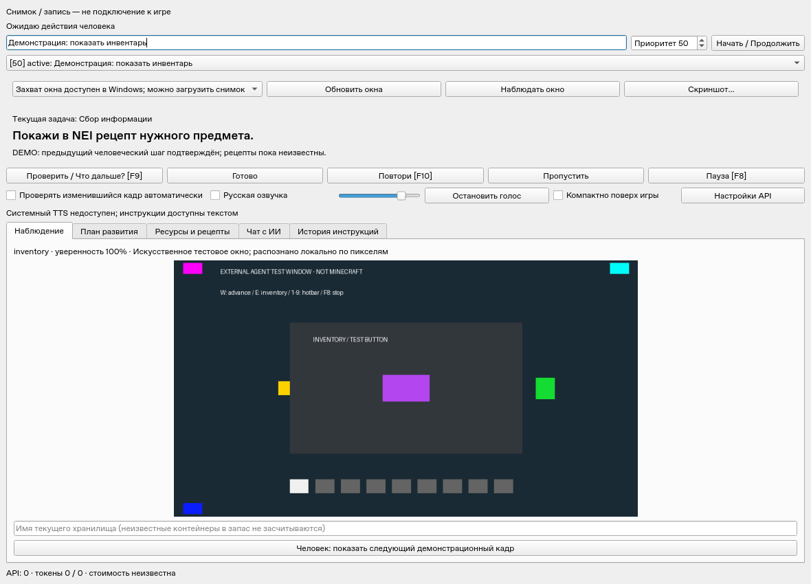

# LoliLand AI Copilot

Отдельное приложение Windows 11 для LoliLand TechnoMagicRPG (Minecraft 1.7.10).
Вы задаёте цель по-русски. ИИ изучает видимый экран, составляет план, выдаёт **одно действие**
и проверяет результат на следующем скриншоте. **Все игровые действия выполняет человек.**

Пример: «Создай автоматическую переработку руд» → «Открой инвентарь» → человек открывает
инвентарь → Copilot проверяет новый кадр → просит показать недостающий рецепт в NEI.
Если конечный предмет не указан, модель должна запросить уточнение.

В программе нет автоматического управления, модов, Forge Bridge, чтения памяти процесса
или игровых пакетов. Minecraft, лаунчер и файлы сборки остаются неизменными.

## Запуск в Windows

1. Установите Python **3.11 x64** с Python Launcher.
2. Выполните `install.bat`.
3. Запустите `start.bat --demo` для цикла на искусственных снимках без API.
4. Для настоящего анализа настройте vision-модель в `.env` по [WINDOWS_SETUP.md](WINDOWS_SETUP.md)
   и выполните `start.bat`.
5. Выберите окно Minecraft, нажмите «Наблюдать окно», введите цель и нажмите «Начать / Продолжить».
   Вернитесь в игру в течение трёх секунд.

В DEMO после инструкции нажмите «Человек: показать следующий демонстрационный кадр», затем
«Проверить». Это смена входного изображения человеком. DEMO не вызывает нейросеть и не доказывает
качество распознавания LoliLand. В offline без настроенного API интеллектуальный план недоступен.



## Что реализовано

- MSS-захват клиентской области выбранного окна, проверка фокуса/PID/размера/DPI;
  загрузка отдельного снимка, локальная запись и воспроизведение PNG/JSONL.
- OpenAI и отдельный OpenAI-совместимый провайдер: visual perception, план, следующая инструкция,
  проверка before/after, чат, извлечение рецептов из документа.
- Один ожидающий шаг. Изменение пикселей само по себе не завершает задачу. Неясность приводит
  к запросу дополнительного вида; «Готово» даёт отдельное явное ручное подтверждение.
- Goal Manager: очередь целей, приоритеты, зависимости, пропуск, пауза, редактирование плана,
  сохранение подтверждённых шагов и автоматическое планирование следующего этапа. После перезапуска цель на паузе, ожидающая инструкция сохранена.
- Recipe KB с версией сборки и источниками NEI/документ/пользователь; расчёт партий, общих запасов,
  остатков, материалов, механизмов и технологических блокеров. Неизвестный рецепт требует данных.
- Частичный учёт видимых слотов и именованных хранилищ. Невидимые запасы не выдумываются;
  устаревшие снимки исключаются. Можно подтвердить ресурсы, координаты базы и механизмы вручную.
- SQLite/WAL, история инструкций и подтверждений, ошибок/исправлений, расход API.
- PySide6: цель, текущая задача, следующая инструкция, скриншот, план, ресурсы, чат, журнал,
  API-настройки и компактная панель поверх игры/работа на втором мониторе.
- Русский системный TTS: включение, громкость, повтор, отмена. Нужен установленный русский голос.
- F8 — пауза, F9 — проверить кадр, F10 — повторить. Это чтение нажатий, игрового ввода нет.
- Автопроверка по умолчанию выключена, интервал 8 секунд (минимум 3), кэш анализа 30 секунд,
  неизменившийся кадр в автопроверке не отправляется в модель. CAPTCHA/staff-проверка ставит цель на паузу.

Скриншоты отправляются выбранному API при запросах распознавания, планирования и проверки.
Чат и импорт документов передают соответствующий текст и контекст памяти. Ключи не пишутся в журнал
и не сохраняются формой настроек. База, снимки, логи и `.env` исключены из Git.

## Разработка и проверка

```bash
uv sync --locked --extra dev
uv run ruff check .
uv run ruff format --check .
uv run mypy src
QT_QPA_PLATFORM=offscreen uv run pytest -q
uv run python -m loliland_agent --demo
```

На Linux можно работать со снимками и replay; захват окна игры и системный голос проверяются в Windows.
Примеры: `start.bat --image C:\screenshots\inventory.png`,
`start.bat --replay examples\replay\observations.jsonl`,
`start.bat --record recordings\session-001` (новый каталог).

[Архитектура](docs/architecture.md) · [Аудит](docs/audit.md) ·
[Проверки](docs/validation.md) · [Ручная приёмка](docs/acceptance.md).

Реальная игровая сессия LoliLand и платный API в облаке не запускались. Заготовленной базы рецептов
сборки нет: Copilot изучает ваши подтверждённые источники. RTX 4050 не требуется при облачном API;
на 6 GB VRAM локальная vision-модель ограничена размером, контекстом и скоростью, поэтому её запуск
остаётся дополнительной настройкой. Распознавание голосовых команд не входит в эту версию.
