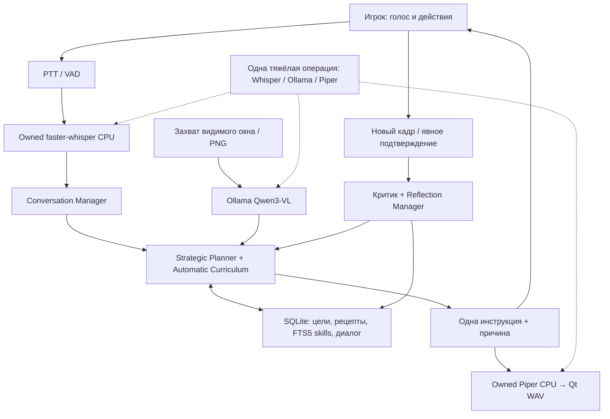

# Архитектура Copilot 0.5

Игрового input executor нет. Единственные Windows-взаимодействия: окно/фокус/DPI, захват экрана, аудио и регистрация горячих клавиш панели. Проверка свободной RAM использует системную статистику ОС, не память Minecraft. Захват не читает файлы клиента и сетевые пакеты.

`CopilotWorker` сериализует изменения плана. `RequestGuard` отбрасывает результаты отменённых запросов. `ConversationWorker` обслуживает диалог отдельно; только явные команды могут изменять текущую цель. Локальные короткие команды не ждут vision LLM. Глобальный `HeavyScheduler` сериализует тяжёлые операции между потоками и asyncio loops; запись/VAD/UI не блокируются. PTT отменяет фоновый запрос и озвучку, автонаблюдение выключается до повторного включения.

`local/ollama.py` использует нативные локальные endpoints, JSON schema, PNG images, bounded response, таймаут, контроль RAM/VRAM до/во время/после запроса и выгрузку. Нет ключа Authorization и облачного fallback. Свободная RAM проверяется перед Whisper/Piper; они исполняются на CPU и закрывают принадлежащие приложению процессы при отмене. Это программные пороги, не гарантированный лимит RSS/VRAM Windows.

`recipes/planner.py` хранит проверяемые источники, спорные рецепты и замены. `learning/curriculum.py` рассчитывает следующую достижимую задачу, DAG крафтов, партии, доступность машин и технологий. `learning/library.py` ищет человеческие процедуры по словам через SQLite FTS5; при отсутствии расширения есть детерминированный поиск сохранённых записей. `learning/reflection.py` сохраняет эпизоды и счётчики неудач. Завершение шага/задачи/главной цели — разные состояния.

Постоянная память — одна SQLite connection с RLock/WAL и транзакциями; активные цели восстанавливаются на паузе. Ручное подтверждение помечается отдельно. Экран/документ/сообщение — недоверенные данные для LLM, не команды на выполнение кода. CAPTCHA/проверка персонала требуют человека.

Подробное сравнение с Voyager и ограничения реализации — [voyager.md](voyager.md).
