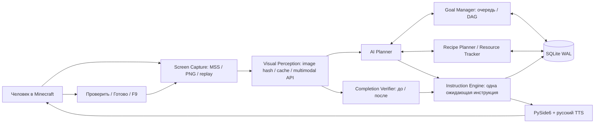

# Архитектура Copilot v0.3

Программа не имеет выхода управления в Minecraft. OS API только перечисляет окна, читает геометрию,
фокус, DPI и уведомительные нажатия F8/F9/F10. Не используется активация окна или синтетический ввод.

| Модуль | Ответственность |
|---|---|
| `perception/sources.py`, `windows.py` | Физический client rect, MSS, PNG, ImageSource, replay; проверка окна до/после кадра |
| `perception/engine.py` | Хэш PNG, проверка целостности, кэш, локальное распознавание только искусственного тестового шаблона; иначе LLM |
| `planning/providers.py` | `AIProvider`, `OpenAIProvider`, `OpenAICompatibleProvider`, offline и явный deterministic demo |
| `planning/task_graph.py`, `goals/manager.py` | Сохранённый DAG, допустимые зависимости, приоритеты, очередь и состояния целей |
| `recipes/planner.py` | Версионная база рецептов с источником, расчёт партий/остатков/машин/технологий/неизвестных зависимостей |
| `resources/tracker.py` | Видимые слоты, именованные контейнеры, ручные подтверждения, исключение устаревших запасов |
| `instructions/engine.py` | Один pending, подтверждение/исправление/пропуск, чат, импорт источников, пауза, защита от устаревших ответов |
| `instructions/verifier.py` | Конкретное доказательство действия по новому изображению; при сложном действии multimodal before/after |
| `memory/store.py` | Транзакции событий/знаний/usage в SQLite, блокировка для UI и worker |
| `speech/tts.py` | Русский системный голос Qt, repeat/cancel/volume, независимый текстовый fallback |
| `ui/app.py`, `worker.py` | Qt main thread и последовательный async actor в QThread |

Ожидающая инструкция содержит ID, исходный PNG и хэш. Новый кадр сравнивается с реальным сохранённым
изображением; картинка до действия не теряется при чистке временного LRU. Неизменившийся кадр даёт
`uncertain`. Открытие запрошенного GUI/рецепта/tooltip допускает локальную проверку структурированного
vision-результата при уверенности ≥95%; сложная операция проверяется LLM по двум PNG. LLM-уверенность
не является гарантией правильности: окончательное достижение главной цели подтверждает человек.

Одно действие может быть частью большой задачи. Задача становится `done` только когда инструкция
отмечена как завершающая её и проверка подтверждает весь результат. Пропуск не удовлетворяет
зависимости. Новые планы модели не могут содержать выполненные шаги или переписывать уже подтверждённые.
Ручное подтверждение доступно после `uncertain`, требует точного ID и имеет отдельную метку `manual`.
Запрос уточняющего вида сохраняется отдельно, чтобы не затереть исходное действие.

F8, смена цели, источника, API, плана и закрытие окна увеличивают revision. Worker отменяет текущую
корутину, а проверки revision после каждого ожидания не позволяют позднему ответу менять план.
HTTP/vision выполняются вне UI-потока. Во время закрытия worker кооперативно отменяется, затем
закрываются источник и SQLite. Секреты в исключениях не выводятся; ошибки API сохраняются как события.

Рецепты сохраняются только полными при высокой уверенности и с доказательством: hash PNG, точная цитата
документа или явное подтверждение пользователя. Точность цитаты проверяется до записи пачки рецептов.
Версия сборки изолирует знания и ресурсы. Стандартных модовых рецептов нет. Неподтверждённые технологии,
альтернативные рецепты, циклы и неизвестные компоненты остаются блокерами; планировщик не объявляет
частичный расчёт полным.

Resource Tracker считает нижнюю границу известных запасов. Повторное чтение слота заменяет значение,
не прибавляет его. Неизвестное количество не учитывается. Игровые контейнеры учитываются только
в сцене storage и под явно заданным именем. Данные старше 5 минут/помеченные stale исключаются.
Новый кадр после invalidation не возвращает старые невидимые слоты. Кэш анализа не освежает запасы.
Ручной общий запас заменяется частичным визуальным снимком, чтобы исключить двойной учёт.

Частота захвата ограничена глобально, auto пропускает неизменные кадры. Полностью одинаковые PNG
кэшируются до 30 секунд; планирование и проверка имеют собственные запросы. Это не обещание одного
API-вызова на шаг. Цены считаются только по явно заданным тарифам и реальным usage-токенам.
