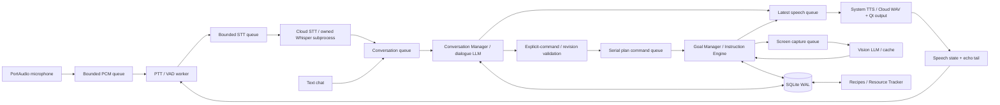

# Архитектура 0.4: независимые голос, диалог и зрение

PySide6 main thread рисует панель и управляет системным TTS/Qt-воспроизведением. PortAudio callback
только копирует PCM в ограниченную очередь. Отдельный VAD-поток сегментирует речь. RecognitionWorker
имеет свой asyncio event loop и очередь до 3 фраз; ConversationWorker — отдельный loop и очередь до
12 сообщений; CopilotWorker — отдельный loop и единственный обработчик изменений плана/зрения.
SynthesisWorker синтезирует облачный WAV вне GUI с отменой старых запросов, Qt играет его из памяти.
Поэтому HTTP анализа изображения не блокирует захват, STT и диалог. Синхронный MSS работает в
потоке CopilotWorker, без активации чужого окна.

Очередь зрительных операций уже существует в CopilotWorker: capture/check/auto последовательно
обрабатываются там. Зрение не запускает конкурирующие записи Goal Manager. Голосовой ответ
содержит лишь предложение команды; UI проверяет revision и передаёт его в ту же очередь.
Проверяются ожидаемая цель и, для откладывания, ожидающая инструкция. При смене цели/плановых
операциях старые запросы отменяются. Локальные команды прерывают долгий диалоговый HTTP-запрос.
Поздний TTS WAV отбрасывается по epoch; системная речь останавливается перед заменой.

PTT/VAD принимают PCM16 mono 16 kHz. При необходимости PortAudio работает на частоте устройства,
ресемплинг выполняется вне callback. Минимум звучащей речи 300 ms, максимум фразы 20 s,
тишина по умолчанию 700 ms. Во время озвучки и 400 ms после неё данные сбрасываются до STT.
Это half-duplex с защитой от собственного голоса, без акустического AEC. Перебивание — кнопкой/PTT.
Переполнение аудиоочереди отбрасывает повреждённую фразу и сообщает об этом.

Whisper — optional extra, multilingual tiny/base, CPU int8 и 2 потока; GPU не выделяется.
Отдельный собственный subprocess держит модель между фразами. Разрешение загрузки передаётся
явным `--download`, иначе local_files_only. Отмена закрывает только этот subprocess, включая
прерванную загрузку модели. При закрытии UI ждёт остановки worker, освобождает микрофон,
завершает Whisper и лишь затем закрывает SQLite. Принудительного завершения QThread нет.

Conversation Manager различает разговор/вопрос/предложение/явную команду, сообщения о ресурсах,
исправления, предпочтения и объяснения. Для изменения плана нужна явная директива; вопросительные
предложения и отрицания не дают разрешения. Модель должна указать точную цитату текущего сообщения.
Базовые явные команды имеют локальный маршрут; свободное обсуждение использует LLM.
Одно сообщение выбирает одну операцию. Отдельные намерения выполняются последовательно.

SQLite хранит полную историю сообщений, канал voice/text, версионный workspace, знания, usage и события.
Последние 24 сообщения и ограниченные сводки дают краткосрочный/долговременный контекст. Сводки
строятся от старейших ещё не свёрнутых записей; исходные сообщения не удаляются. Заметки имеют
источник user_report / ai_assumption. Цитата пользователя сохраняется дословно, парафраз модели —
как interpretation. Сводка и предположение не становятся доказательством рецепта/запаса.
Зрительные факты продолжают иметь hash PNG, рецепты — версию сборки и источник.

Рецепты/нижняя граница ресурсов доступны обоим LLM-маршрутам через одну Memory. Голосовые сообщения
о ресурсах передаются планировщику как user reports; они не увеличивают визуально подтверждённые
количества. Подтверждённые и отложенные задачи с необходимыми зависимостями сохраняются при новом
этапе плана. Никакая фраза «я закончил» сама по себе не даёт visual completion.

Рабочие ключи хранятся в Windows Credential Manager, настройки без ключей — в data/settings.json.
Cloud STT/TTS используют отдельный URL/ключ; ключ LLM не пересылается другому hostname.
HTTP имеет таймауты, лимиты ответа, TLS и запрет redirects. Голосовые цены не подменяются LLM usage.
Сырые записи микрофона и WAV не сохраняются на диск.
